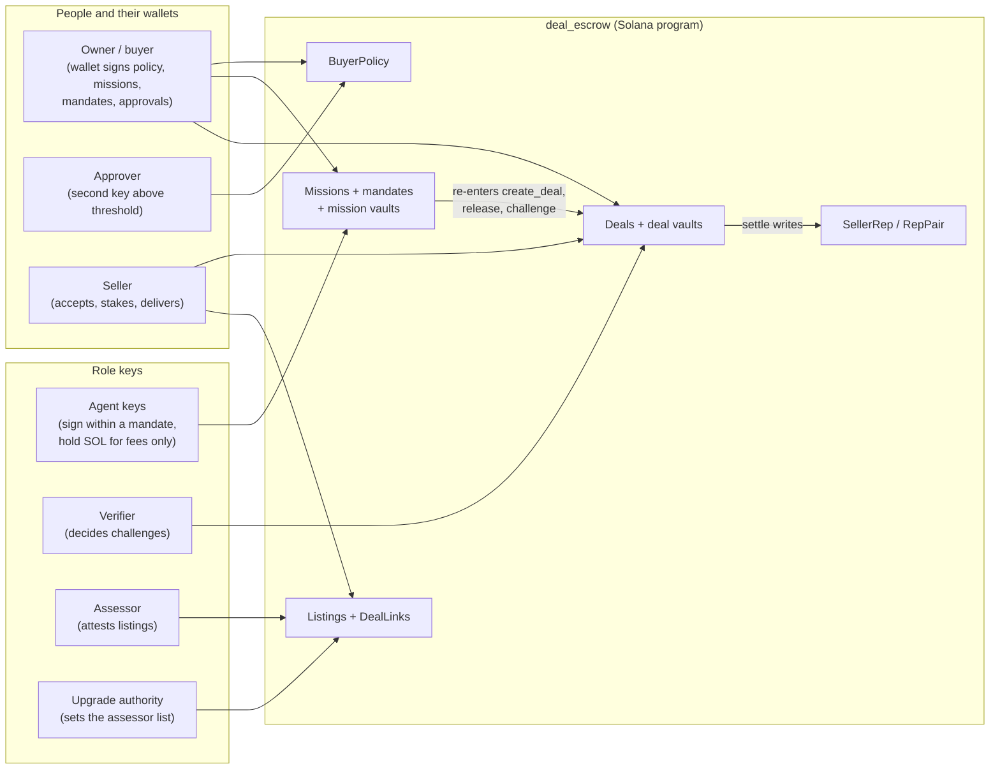
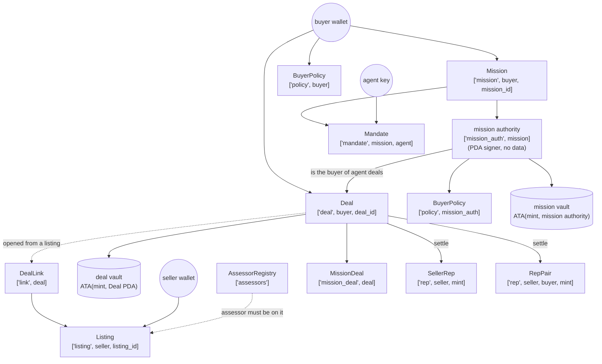
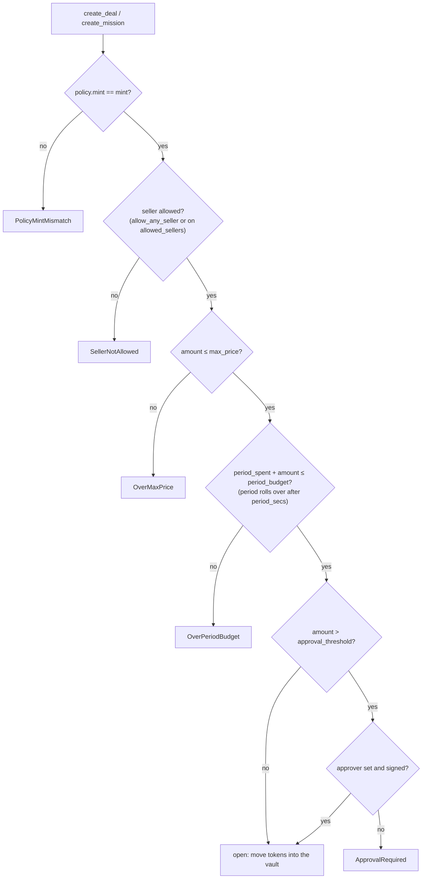
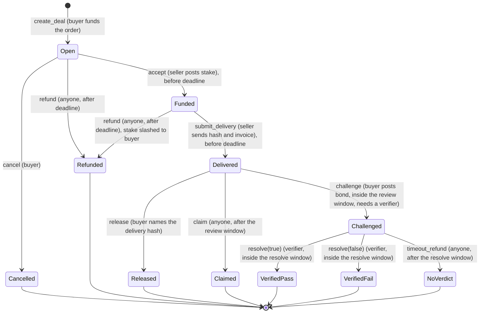
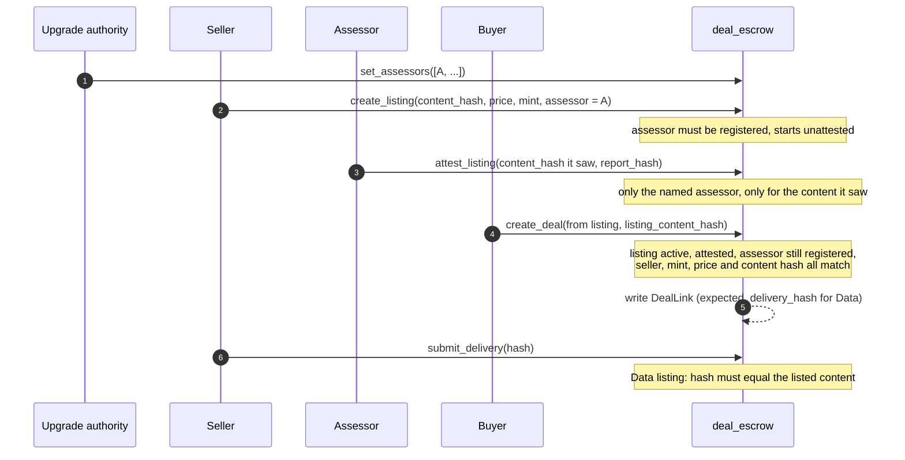
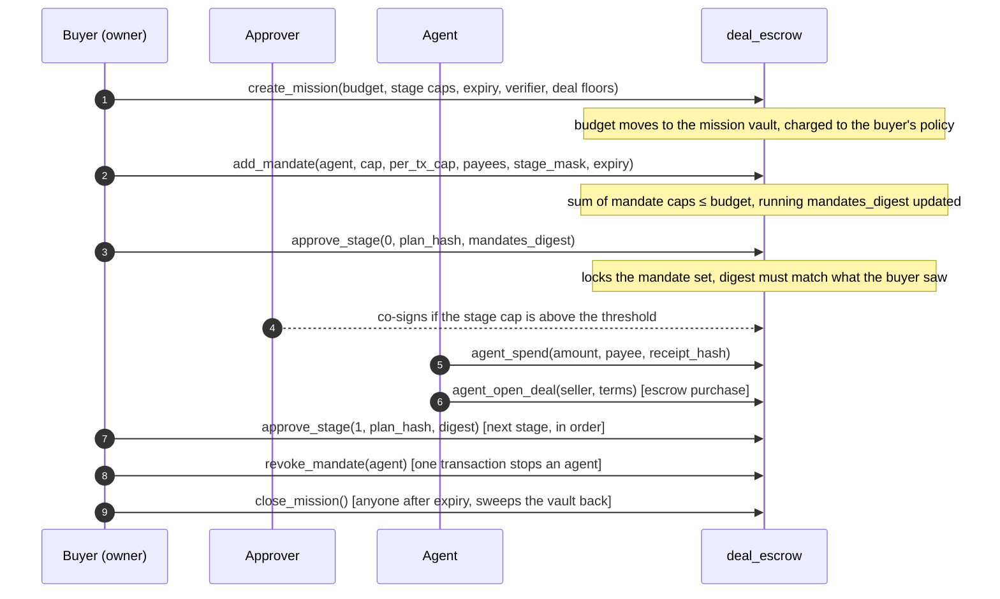
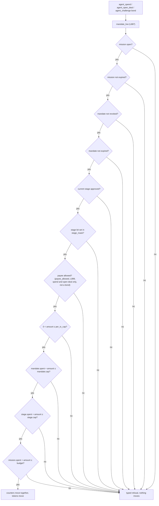
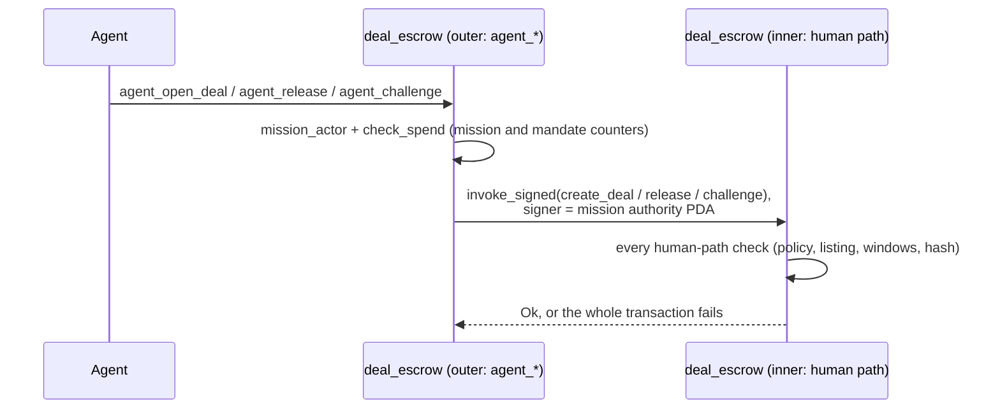
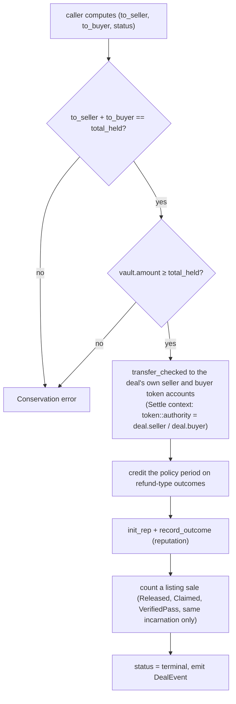
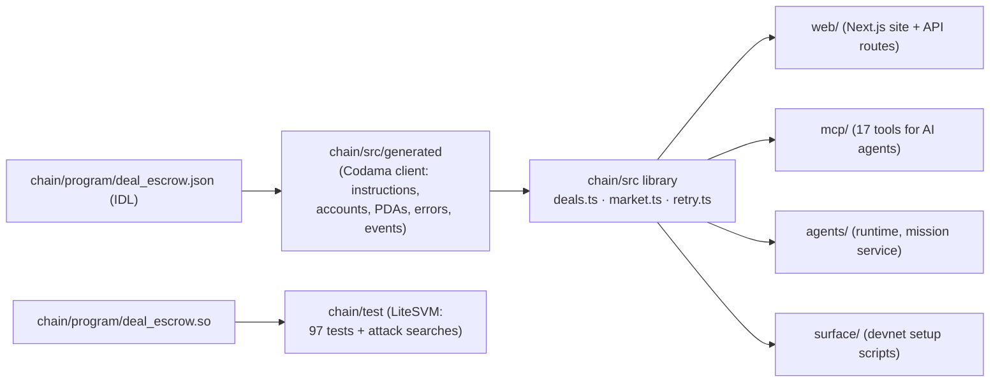

# Program architecture: `deal_escrow`

> How Fiducia's Solana program is built, for someone about to read or audit it.
> Companion to [`SECURITY-AUDIT.md`](SECURITY-AUDIT.md) (scope, roles, invariants, evidence, open items).
> Line numbers refer to [`chain/anchor/programs/deal_escrow/src/lib.rs`](../chain/anchor/programs/deal_escrow/src/lib.rs),
> unchanged since commit `4b98dd9` (4 Oct 2026) and byte-for-byte the program deployed on devnet
> (`CfD43mq2P1mVVpKxueo1XDe6UrQBCF3DZjNmDGQNVGSV`).

## Contents

1. [The program in one minute](#1-the-program-in-one-minute)
2. [System context](#2-system-context)
3. [Code map: where everything is in `lib.rs`](#3-code-map)
4. [Account model](#4-account-model)
5. [Layer 1: buyer policy](#5-layer-1-buyer-policy)
6. [Layer 2: escrow deals](#6-layer-2-escrow-deals)
7. [Layer 3: listings and assessors](#7-layer-3-listings-and-assessors)
8. [Layer 4: missions and agent mandates](#8-layer-4-missions-and-agent-mandates)
9. [The program calling itself (self-CPI)](#9-the-program-calling-itself-self-cpi)
10. [Settlement: the single exit](#10-settlement-the-single-exit)
11. [Reputation](#11-reputation)
12. [Bounds and constants](#12-bounds-and-constants)
13. [Errors and events](#13-errors-and-events)
14. [Off-chain side: client library and callers](#14-off-chain-side-client-library-and-callers)
15. [Design principles](#15-design-principles)
16. [Planned module layout (audit-freeze commit)](#16-planned-module-layout-audit-freeze-commit)

---

## 1. The program in one minute

`deal_escrow` turns "give an agent a wallet" into "give an agent a **mandate**". It is built as four layers, each using the one below it:

| Layer | Question it answers | Instructions |
|---|---|---|
| **4. Missions and mandates** | Which agent may spend how much, on whom, in which approved stage, until when? | 9 |
| **3. Listings and assessors** | What exactly is being sold, and did an independent assessor check it? | 5 |
| **2. Escrow deals** | Is the money held until a delivery is proven, with a fair way out on every path? | 10 |
| **1. Buyer policy** | How much may this owner spend per period, at what price, with which sellers, and when is a second signature needed? | 2 |

Three ideas carry the whole design:

- **Money has one exit per vault.** A deal's tokens leave only through `settle` (L1028), which checks conservation first. A mission's tokens leave only through four agent or buyer paths, each counted against caps.
- **Agents never hold tokens.** An agent signs, but the tokens sit in program-owned vaults. Every token an agent moves passes `check_spend` (L869): mission, mandate, stage gate, then every cap from the smallest scope outwards.
- **Agents reuse the human path.** When an agent buys under escrow, the program re-enters its own `create_deal`, `release` and `challenge` (section 9), so an agent can never get a weaker deal than a human buyer.

## 2. System context



Off chain, the web app, the MCP server and the agent runtime only **build and sign** transactions with keys they are allowed to hold (section 14). Nothing off chain can move tokens; the program decides every movement.

## 3. Code map

`lib.rs` is one 1,979-line file, laid out in a fixed order. Read it top to bottom in this order:

| Lines | Region | What's there |
|---|---|---|
| 1–35 | Module doc | The design in prose, with the source of each idea |
| 36–67 | Imports, `declare_id!`, constants | PDA seeds and every bound (section 12) |
| 69–852 | `#[program] mod deal_escrow` | The 26 instructions (table below) |
| 856–927 | Mission helpers | `mission_actor` L856, `check_spend` L869, `mandate_live` L887, `payee_allowed` L899, `mandate_digest` L913 |
| 929–1001 | Deal helpers | `read_deal` L929, `invoke_settle` L936 (self-CPI), `total_held` L969, `pass_split` L978, `invoice_matches` L991, `bps_of` L999 |
| 1003–1136 | Token movement and settlement | `move_in` L1003, **`settle` L1028**, `read_link` L1080, `init_rep` L1090, `record_outcome` L1107 |
| 1138–1465 | Parameters, state accounts, enums, events | `PolicyParams`, `DealParams`, `BuyerPolicy` L1174, `Deal` L1193, `Listing` L1252, `AssessorRegistry` L1276, `DealLink` L1286, `Mission` L1345, `MissionDeal` L1378, `Mandate` L1387, `SpendEvent` L1404, `SellerRep` L1415, `RepPair` L1435, `DealStatus` L1446, `DealEvent` L1461 |
| 1467–1863 | Account contexts (`#[derive(Accounts)]`) | One per instruction family; the `Settle` context (L1836) is shared by every settle path |
| 1865–1979 | `DealError` | 56 typed errors |

### Every instruction

| Line | Instruction | Signer | Context | Moves tokens | Event |
|---|---|---|---|---|---|
| 74 | `init_policy` | buyer | `InitPolicy` | no | |
| 95 | `update_policy` | buyer | `UpdatePolicy` | no | |
| 109 | `create_deal` | buyer (+ approver above threshold) | `CreateDeal` | buyer → deal vault (order) | `DealEvent(Open)` |
| 214 | `set_assessors` | upgrade authority | `SetAssessors` | no | |
| 231 | `create_listing` | seller | `CreateListing` | no | |
| 258 | `attest_listing` | the listing's assessor | `AttestListing` | no | |
| 272 | `update_listing` | seller | `UpdateListing` | no | |
| 300 | `close_listing` | seller | `CloseListing` | no | |
| 305 | `cancel` | buyer | `Settle` | deal vault → buyer | `DealEvent(Cancelled)` |
| 314 | `accept` | seller | `Accept` | seller → deal vault (stake) | `DealEvent(Funded)` |
| 340 | `submit_delivery` | seller | `SubmitDelivery` | no | `DealEvent(Delivered)` |
| 361 | `release` | buyer | `Settle` | deal vault → seller, buyer | `DealEvent(Released)` |
| 372 | `claim` | anyone, after the review window | `Settle` | deal vault → seller, buyer | `DealEvent(Claimed)` |
| 383 | `challenge` | buyer, inside the review window | `Challenge` | buyer → deal vault (bond) | `DealEvent(Challenged)` |
| 411 | `resolve` | the deal's verifier | `Settle` | deal vault → seller, buyer | `DealEvent(VerifiedPass/Fail)` |
| 429 | `timeout_refund` | anyone, after the resolve window | `Settle` | deal vault → buyer, seller | `DealEvent(NoVerdict)` |
| 441 | `refund` | anyone, after the deadline | `Settle` | deal vault → buyer | `DealEvent(Refunded)` |
| 457 | `create_mission` | buyer (+ approver above threshold) | `CreateMission` | buyer → mission vault (budget) | |
| 548 | `add_mandate` | buyer | `AddMandate` | no | |
| 583 | `approve_stage` | buyer (+ approver above threshold) | `ApproveStage` | no | |
| 612 | `agent_spend` | agent | `AgentSpend` | mission vault → payee | `SpendEvent` |
| 640 | `agent_open_deal` | agent | `AgentOpenDeal` | mission vault → deal vault (via `create_deal`) | `SpendEvent`, `DealEvent(Open)` |
| 745 | `agent_release` | agent that opened the deal, or buyer | `AgentSettle` | deal vault → seller, mission vault (via `release`) | `DealEvent(Released)` |
| 756 | `agent_challenge` | agent that opened the deal, or buyer | `AgentChallenge` | mission vault → deal vault (bond, via `challenge`) | `DealEvent(Challenged)` |
| 796 | `revoke_mandate` | buyer | `RevokeMandate` | no | |
| 804 | `close_mission` | buyer any time; anyone after expiry | `CloseMission` | mission vault → buyer | |

## 4. Account model



| Account | Seeds | Key fields | Written by |
|---|---|---|---|
| `BuyerPolicy` (L1174) | `"policy", buyer` | `mint`, `period_secs/start/budget/spent`, `max_price`, `approval_threshold`, `approver`, `allow_any_seller`, `allowed_sellers` (≤ 8) | `init_policy`, `update_policy`, `create_deal`, `create_mission`, `settle` (budget credit), `close_mission` |
| `Deal` (L1193) | `"deal", buyer, deal_id` | parties, `verifier`, `amount`, `invoice_amount`, `tolerance_bps`, `stake_required/posted`, `bond_bps/posted`, `deadline`, `review_secs`, `resolve_secs`, `terms_hash`, `delivery_hash`, timestamps, `status` | the deal instructions |
| `Listing` (L1252) | `"listing", seller, listing_id` | `kind` (Data, Service, Team), `mint`, `price`, `content_hash`, `meta_hash`, `assessor`, `report_hash`, `assessed_at`, `active`, `sales`, `created_at` | listing instructions; `settle` counts `sales` |
| `AssessorRegistry` (L1276) | `"assessors"` | `authority`, `assessors` (≤ 16) | `set_assessors` |
| `DealLink` (L1286) | `"link", deal` | `listing`, `expected_delivery_hash`, `listing_created_at` | `create_deal` (only when opened from a listing) |
| `Mission` (L1345) | `"mission", buyer, mission_id` | `budget`, `spent`, `mandate_caps`, `mandates_digest`, `mandates_locked`, `stages` (≤ 8: cap, spent, plan hash, approved_at), `current_stage`, `expires_at`, `closed`, deal floors (`min_review_secs`, `min_resolve_secs`, `max_tolerance_bps`, `max_bond_bps`, `min_stake_bps`), `verifier` | mission instructions |
| `Mandate` (L1387) | `"mandate", mission, agent` | `cap`, `per_tx_cap`, `spent`, `payees` (≤ 8), `stage_mask`, `expires_at`, `revoked` | `add_mandate`, `check_spend`, `revoke_mandate` |
| `MissionDeal` (L1378) | `"mission_deal", deal` | `mission`, `deal`, `agent` (who opened it) | `agent_open_deal` |
| `SellerRep` (L1415) / `RepPair` (L1435) | `"rep", seller, mint` / `"rep", seller, buyer, mint` | `completed`, `failed`, `neutral`, `volume`, `distinct_buyers`, `max_pair_volume`, `last_settled_at` | **only** `settle` → `record_outcome` |

Ids are `u64`, little-endian in the seeds. The two vaults are associated token accounts, so their addresses follow from (mint, owner PDA) and cannot be swapped.

## 5. Layer 1: buyer policy

A buyer can open a deal or fund a mission only through its `BuyerPolicy`. The checks in `create_deal` (L109) and `create_mission` (L457) **fail closed**:



The seller check applies to deals. A mission is checked on its budget and approver; its own deals then obey the buyer's seller allowlist and max price through the policy `create_mission` sets up for the mission authority. An unset approver means nobody can approve, so large amounts are refused. `update_policy` keeps `period_spent`, so changing the policy can't reset the budget. Refund-type outcomes credit the amount back to the period (`settle`, `credit_budget`).

## 6. Layer 2: escrow deals

### State machine



Every arrow into a terminal state goes through `settle` (section 10). Every non-terminal state has a time-based way out that **anyone** can trigger, so funds can't be locked by a party going silent:

| Stuck in | Who goes silent | Way out | Who may call |
|---|---|---|---|
| `Open` | seller never accepts | `refund` after `deadline` | anyone |
| `Funded` | seller never delivers | `refund` after `deadline` (stake slashed to buyer) | anyone |
| `Delivered` | buyer never reviews | `claim` after `delivered_at + review_secs` | anyone |
| `Challenged` | verifier never decides | `timeout_refund` after `challenged_at + resolve_secs` | anyone |

### Who gets what

`total_held = amount + stake_posted + bond_posted`. `payout = min(invoice_amount, amount)`.

| Terminal status | To seller | To buyer | Budget credited | Reputation |
|---|---|---|---|---|
| `Released`, `Claimed` | payout + stake | (amount − payout) + bond | no | completed (+payout volume) |
| `VerifiedPass` | payout + stake + **bond** | amount − payout | no | completed |
| `VerifiedFail` | 0 | everything (stake **slashed**) | yes | failed |
| `NoVerdict` | stake | amount + bond | yes | neutral |
| `Refunded` (after accept) | 0 | everything (stake **slashed**) | yes | failed |
| `Refunded` (never accepted) | 0 | amount | yes | neutral |
| `Cancelled` | 0 | amount | yes | neutral |

### Checks at the edges

- **Open** (`create_deal`, L109): amount > 0; deadline in the future and ≤ 30 days out; review window ≤ 30 days; tolerance ≤ 20 %; bond ≤ 50 %; buyer ≠ seller; if a verifier is named it must differ from both, with a resolve window of 60 s to 30 days; then the policy (section 5); then the listing (section 7).
- **Deliver** (`submit_delivery`, L340): non-empty hash; invoice within `amount ± tolerance` (`invoice_matches`, L991; a zero invoice never matches); for a Data listing, the hash must equal the listed content.
- **Release** (L361): the buyer names the exact `delivery_hash` it approves, so an approval can't be replayed against a different delivery.
- **Challenge** (L383): only with a verifier; inside the review window; the bond is computed from `bond_bps`, not passed in.
- **Slashing** is always computed from chain time and state, never from a flag a caller passes in.

## 7. Layer 3: listings and assessors



- **Changing what is sold clears the attestation.** `update_listing` may change price and availability while keeping the attestation; changing the content or metadata zeroes `report_hash`.
- **Incarnations.** `DealLink.listing_created_at` records which incarnation of the listing PDA the deal came from. A listing that is closed and recreated has a new `created_at`, so it never collects the old deals' sales.
- **The link can't be hidden.** `Settle` and `SubmitDelivery` always take the `DealLink` at its PDA (seeds constrained). An empty account means "no listing"; any other account is rejected.
- **Assessor registry.** `set_assessors` (L214) checks the signer against the upgrade authority stored in the program's ProgramData header. Deals and agent payments re-check the registry every time, so removing an assessor takes effect at once.

## 8. Layer 4: missions and agent mandates

### Lifecycle



### The spend gate

Every token an agent moves, whether a direct payment, an escrow deal or a challenge bond, passes `check_spend` (L869). The order is fixed: liveness first, then each cap from the smallest scope outwards. A payment is accepted **only if every line passes**:



- **Payees.** If the mandate lists payees, only they qualify. With an empty list, only the seller of an active, attested listing in the mission's mint qualifies, and its assessor must still be registered.
- **`spent` only grows.** Refunds that come back to the mission vault never reduce `spent`; caps limit outflow.
- **Mandates lock at the first approval.** `approve_stage(0)` must name the `mandates_digest`, a running sha256 over every mandate in order. The buyer therefore approves exactly the agent set it saw, and no mandate can be added afterwards.
- **Stages advance in order** (`s == current + 1`). Each one needs its own human approval and plan hash.
- **Deal floors.** A mission fixes minimum review and resolve windows, a maximum tolerance and bond, and a minimum seller stake. Agents can't open deals weaker than these (*agents cannot weaken a deal* test).
- **Who may release or challenge.** Only the agent that opened a mission deal (recorded in `MissionDeal`) or the buyer may. The buyer can still challenge after revoking the agent or closing the mission.

## 9. The program calling itself (self-CPI)

Agents buy through the **same** code path as a human buyer. The mission authority PDA plays the buyer role and signs a CPI back into this program:



| Outer | Inner | What the outer adds |
|---|---|---|
| `agent_open_deal` (L640) | `create_deal` | spend gate, payee check, deal floors; writes `MissionDeal` (which agent opened it) |
| `agent_release` (L745) via `invoke_settle` (L936) | `release` | opener-or-buyer check, live mandate for agents; moves nothing from the mission vault, so no cap is charged |
| `agent_challenge` (L756) | `challenge` | opener-or-buyer check; the bond counts as spend (agent: every cap; buyer: the mission budget) |

**No stale write-back.** Anchor writes typed accounts back when an instruction exits. Every program-owned account the inner instruction writes (deal, policy, reputation, link, listing) is therefore an `UncheckedAccount` in the outer context, read with an owner and discriminator check (`read_deal`, `read_link`). The vaults are token accounts, which Anchor never serialises back. The outer instruction writes only mission and mandate counters, which the inner one never touches. `deal_program` is constrained to this program's id.

## 10. Settlement: the single exit

`settle` (L1028) is the only code that moves tokens **out of a deal vault**. Seven instructions end in it: `cancel`, `release`, `claim`, `resolve` (both verdicts), `timeout_refund`, `refund`, and `agent_release` via `release`.



A caller can't redirect a payout: the destination accounts are constrained to the deal's own parties (test: *a caller cannot redirect a payout to their own token account*). A sales count never blocks a payout; a listing closed meanwhile is simply not counted.

## 11. Reputation

`record_outcome` (L1107) runs only inside `settle`, so a reputation change always comes with a real payout:

| Outcome | `SellerRep` / `RepPair` |
|---|---|
| `Released`, `Claimed`, `VerifiedPass` | `completed += 1`, `volume += min(invoice, amount)` (never stake or bond), `distinct_buyers` on a pair's first completion, `max_pair_volume` |
| `VerifiedFail`, or `Refunded` after the seller accepted | `failed += 1` |
| `Cancelled`, `NoVerdict`, `Refunded` never accepted | `neutral += 1` |

Reputation is **keyed by mint**, so deals in a token the seller minted themselves never touch the USDC record. The program keeps honest counts only. Scoring (minimum deals, distinct buyers, concentration) is a pure function in [`core/`](../core), off chain.

## 12. Bounds and constants

| Constant | Value | Bounds |
|---|---|---|
| `MAX_WINDOW_SECS` | 30 days | deadline distance, review window, resolve window, mission expiry |
| `MIN_RESOLVE_SECS` | 60 s | a verifier always gets a real window |
| `MAX_TOLERANCE_BPS` | 2,000 (20 %) | invoice tolerance |
| `MAX_BOND_BPS` | 5,000 (50 %) | challenge bond |
| `MAX_STAGES` | 8 | stages per mission (`stage_mask` is a `u8`) |
| `MAX_PAYEES` | 8 | payees per mandate |
| `MAX_ALLOWED_SELLERS` | 8 | sellers per policy |
| `MAX_ASSESSORS` | 16 | registry size |

All vectors are bounded, so account sizes are fixed at `init` (`InitSpace`). Counters use checked math; basis-point math runs in `u128`; `saturating_add` is used only to compute window ends from timestamps.

## 13. Errors and events

- **56 typed errors** (`DealError`, L1866). The refusals a client sees by name include `OverPerTxCap`, `OverMandateCap`, `OverStageCap`, `OverMissionBudget`, `OverPeriodBudget`, `OverMaxPrice`, `SellerNotAllowed`, `PayeeNotAllowed`, `StageNotApproved`, `MandateRevoked`, `DeliveryMismatch`, `NotListedContent`, `Conservation`, `VerifierNotIndependent`. The client library returns them as named refusals, not exceptions.
- **Two events:** `DealEvent { deal, status }` on every status change (5 emit sites, one of them inside `settle`), and `SpendEvent { mission, agent, payee, amount, receipt_hash }` on every agent spend. `receipt_hash` commits to the off-chain context that justified the payment. Together they are enough to monitor every token movement.

## 14. Off-chain side: client library and callers



- **`deals.ts`**: `safeSend` decides "did it land?" from the chain after any uncertain error and never sends a landed transaction twice. `exactlyOnce` mode serves actions the program accepts more than once (`agent_spend`, incident #210): it waits out the blockhash window before trusting a "not landed" read.
- **`market.ts`**: listing and mission flows, plus `mandatesDigest`, which mirrors the program's `mandate_digest` so the UI shows the buyer exactly what it approves.
- **Keys.** Users' wallets sign everything the owner does. Servers hold only role keys (agents, verifier, assessor) and are bounded by the program: a stolen agent key can lose at most the rest of its own mandate.
- **The binary in the repo is the binary on chain.** The tests load `chain/program/deal_escrow.so`, which a fresh `cargo build-sbf` reproduces byte for byte and which matches the deployed program ([`SECURITY-AUDIT.md`](SECURITY-AUDIT.md#reproducible-build)).

## 15. Design principles

1. **Fail closed.** No approver means no large amounts; no verifier means no challenge; no payee list means attested listings only.
2. **One exit per vault.** Deal tokens leave only through `settle`; mission tokens leave only through the counted agent paths or `close_mission`.
3. **Compute, don't trust.** Slashing, bonds, payouts and windows come from chain state and time, never from caller-supplied flags.
4. **Bind approvals to content.** Release names the delivery hash; a stage approval names the plan hash and the mandate digest; a deal from a listing binds the content hash the buyer saw.
5. **Nobody can lock funds by going silent.** Every non-terminal deal state has a permissionless, time-based exit.
6. **Agents get the human path, never a shortcut.** Self-CPI into `create_deal`, `release` and `challenge`.
7. **Reputation only from payouts**, kept per mint.
8. **Bounded everything.** Vectors, windows, basis points.

## 16. Planned module layout (audit-freeze commit)

The single file is deliberate for now: changing the source would break the byte-for-byte match with the deployed program. The audit-freeze commit splits it **without logic changes** (tests and attack search must pass unchanged):

```text
programs/deal_escrow/src/
├── lib.rs                 # declare_id!, #[program] with thin handlers only
├── constants.rs           # seeds and bounds (section 12)
├── errors.rs              # DealError
├── events.rs              # DealEvent, SpendEvent
├── state/                 # policy.rs, deal.rs, listing.rs, mission.rs, reputation.rs
├── instructions/
│   ├── policy.rs          # init_policy, update_policy
│   ├── deal.rs            # create_deal … refund  (+ Settle context)
│   ├── listing.rs         # set_assessors, create/attest/update/close_listing
│   └── mission.rs         # create_mission … close_mission
└── logic/
    ├── settle.rs          # settle, pass_split, total_held, move_in
    ├── spend.rs           # check_spend, mandate_live, payee_allowed, mandate_digest
    ├── cpi.rs             # invoke_settle and the self-CPI builders
    └── reputation.rs      # init_rep, record_outcome
```

The same commit applies `cargo fmt` and the one clippy suggestion. See the plan in [`SECURITY-AUDIT.md`](SECURITY-AUDIT.md#plan-to-mainnet-security-track).
